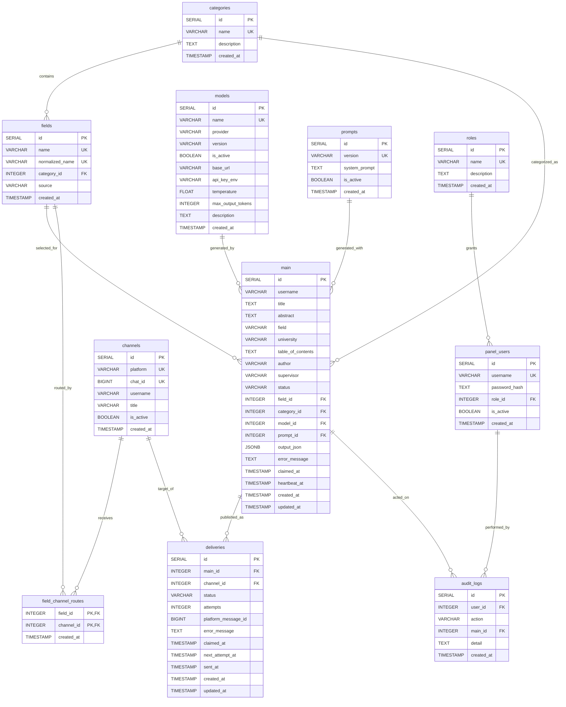

# Entity Relationship Diagram

`main.status` is the generation lifecycle: `ready`, `processing`, `review`,
`failed`, plus `rejected` (explicit human rejection from `review` via
`PATCH /records/{id}`). `deliveries.status` is the separate publishing lifecycle: `pending`,
`sending`, `sent`, `failed`, `awaiting_confirmation` (reserved for the planned
human confirmation step, never written today).
