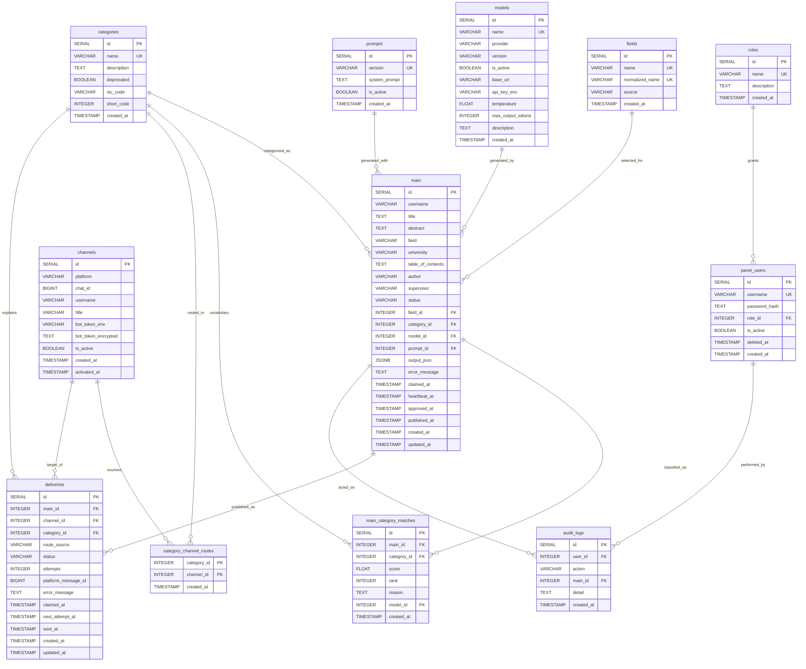

# Entity Relationship Diagram



## Schema notes

- `categories.deprecated` retires a category without breaking its foreign
  keys. The pre-ISCED vocabulary was remapped and removed by migration 024;
  `isc_code` is indicative metadata only.
- `fields` is only a normalized dedup identity. It has no category, keyword,
  or channel route; `main.field_id` references it for audit/dedup, and neither
  classification nor routing reads the field row.
- `main.category_id` is the display primary category (the rank-1 match).
  The full multi-category answer lives in `main_category_matches`, which is
  what routing reads.
- `main_category_matches` stores one row per category match. Rank 1 is the
  primary; scores are clamped to 0..1. A manual override replaces all rows with
  one score-1.0 match; clearing returns the single `other` fallback. Routing
  reads only qualifying, non-deprecated, non-`other` matches at or above
  `MIN_CATEGORY_RELEVANCE`.
- `panel_users.deleted_at` tombstones removed accounts so audit history still
  resolves the author.
- `channels.activated_at` is the channel start line: articles created before
  it are never delivered there, so a newly enabled channel does not receive
  the archive.
- `category_channel_routes` is the strict routing matrix. A category reaches
  exactly the channels selected on `/categories`; a category with no routes
  publishes nothing.
- `deliveries` records one row per article × channel and carries the send
  status, attempt count, provider message id, and error.

`main.status` is the generation lifecycle: `ready`, `processing`, `review`,
`approved`, `published`, `failed`, `rejected` (explicit human rejection from
`review`). The allowed transitions live in exactly one place,
`app/services/transitions.py` (`RECORD_TRANSITIONS` / `DELIVERY_TRANSITIONS`),
and no route sets a status by hand:

```
ready --claim--> processing --generated--> review --approve--> approved --sent--> published
                     |                          |                                 (terminal)
                     | error                    | reject -> rejected (terminal)
                     v                          +-- regenerate fails -> failed --regenerate--> review
                   failed
```

`review -> published` also exists for deployments running with
`REQUIRE_HUMAN_CONFIRMATION=false`: there the first successful send is the
decision point. `approved_at`/`published_at` stamp the decision and the first
publication (first-wins), but the statuses now carry the same facts, so the
panel never infers "approved" from a timestamp — this is what fixed the
records that stayed in "نیازمند تأیید" after their deliveries were sent.

Two migrations repair the existing rows (both additive; neither edits an
applied file):

- `016` widens `ck_main_status` and backfills from the timestamps. That alone
  left 43 rows still reading `review`, because their deliveries were sent
  *before* `published_at` existed (added in migration 013).
- `017` derives the truth from `deliveries`: an article whose deliveries are
  **all** `sent` becomes `published`, with `published_at` set to the earliest
  real send time and `approved_at` back-filled from the earliest `approve`
  audit row. Articles with any delivery still unsent are untouched — for those
  the state genuinely is not published yet — and `rejected` is never rewritten
  (a human rejection stays the final word even if a send had happened).

After 017 the invariant holds: no row is `approved`/`review` while all of its
deliveries are `sent`.

`deliveries.status` is the separate publishing lifecycle:
`awaiting_confirmation`, `pending`, `sending`, `sent`, `failed`
(and `deleted_from_channel` when an operator deletes the published message):
`awaiting_confirmation` is the gated initial status while
`REQUIRE_HUMAN_CONFIRMATION` is on; approving the record flips it to `pending`.

An article reaches **the channels its qualifying category matches name**:
every row in `main_category_matches` with `score >= MIN_CATEGORY_RELEVANCE`
(in a live category, never `other`) contributes that category's
`category_channel_routes`, and the per-channel union is what gets queued —
a channel reached through two of the record's categories gets ONE delivery
(`route_source` = the category name, or `multi` when the union coincides).
Each delivery snapshots the top-1 match's `category_id` at queue time (an
audit-only simplification in the multi-category case), so a send stays
explainable after later edits. Excluded channels are `is_active = false` and
`channels.activated_at > main.created_at` — a channel never receives news
that predates the moment it was switched on, which is what stops a newly
routed channel from being flooded with the archive. A record whose only
match is the `other` fallback reaches **no channel at all** and waits for a
reviewer. There is no field-level routing fallback.
